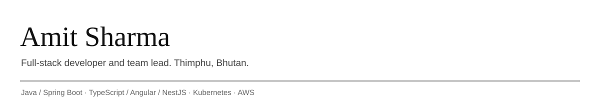

I lead a small development team at a software company in Bhutan. Most of what we build is for government: an ERP system for a municipality, citizen-facing portals, single sign-on, and the infrastructure that runs them.

I started in 2023 on the frontend, moved to full-stack, picked up DevOps because someone had to own the deployments, and now lead projects end to end.

### What I work with

- **Backend:** Java and Spring Boot day to day, with Spring Cloud Gateway and Eureka for our microservices. Node.js and NestJS on newer projects.
- **Frontend:** Angular with NG-ZORRO. Ionic/Capacitor for mobile, including a native barcode-scanner plugin I wrote for a rugged handheld device.
- **Infrastructure:** Docker, a private Harbor registry, Jenkins and Helm pipelines, Kubernetes on-prem and on AWS, Nginx in front of all of it.
- **Data:** PostgreSQL, MariaDB, MySQL.

### Things I've done that I'm glad I did

- Took an ERP system with dozens of modules from monolith to services deployed on Kubernetes.
- Set up the CI/CD pipelines my team now uses for every release.
- Integrated biometric attendance hardware with a Spring Boot backend through the vendor's SDK.
- Handled key rotation with AWS KMS and SSO integration with a national identity provider.

### Certifications

AWS Certified Cloud Practitioner, GSDC DevOps, DevSecOps. Diploma in Cybersecurity (2023).

### Contact

[LinkedIn](https://www.linkedin.com/in/amit-sharma-6a2194188) · sethsharma38@gmail.com
